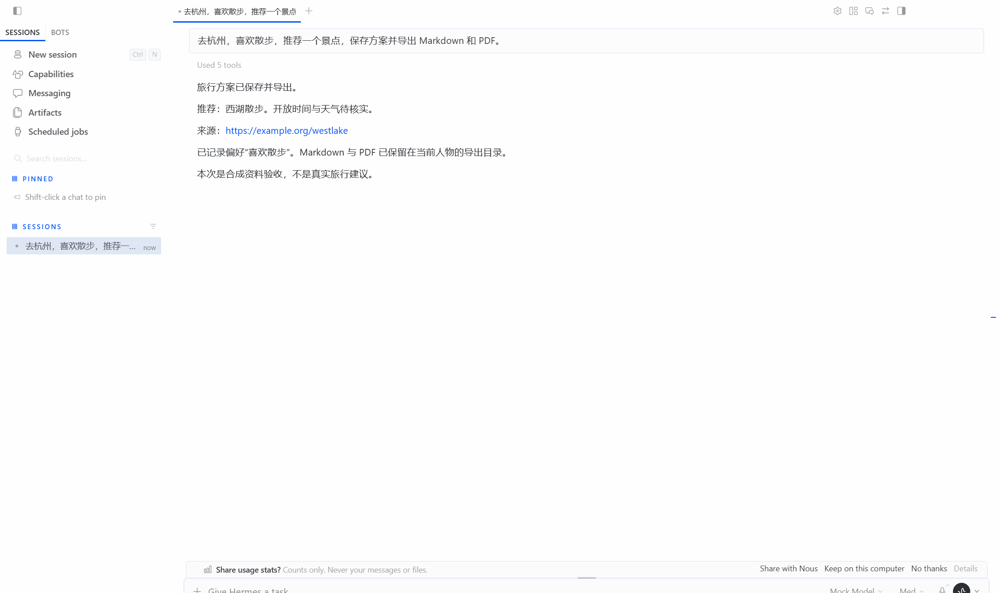

# Hermes 旅行增强

在完整 Hermes 官方源码与原生 Desktop 上，增加直接搜索、可溯源人物偏好和有来源的旅行方案。增强源码集中在 [travel_extensions](travel_extensions/)，不另写 Agent 运行框架或桌面。

> 核心迁移、受控桌面验收与一次 Sol 中转真实链路已完成；本地 Langfuse 已真实入库但发现观测缺口；DeepSeek 官方新链路尚待验收。下表是进度唯一入口。[原版 README](https://github.com/NousResearch/hermes-agent/blob/ccc695635094d7615373db267b77f894d978b1a0/README.md) 和 [LICENSE](LICENSE) 保留上游介绍与版权。

你可以说明目的地、饮食/住宿/景点偏好，让 Hermes 原生子 Agent 查资料，再将通过审查的候选保存成带来源的方案。冲突偏好保留证据，等待用户确认；资料不足会记录缺口。当前提供旅行资料整理，不支持预订、付款或地图路线计算。



## 运行起来

当前验证环境为 Windows、PowerShell 7、Git、Node.js 24；Python 3.14 由 Hermes 官方 PM 安装。先在本仓库根目录运行：

```powershell
$env:UV_INDEX_URL = 'https://pypi.org/simple'
pwsh.exe -NoLogo -NoProfile -NonInteractive -ExecutionPolicy Bypass -File ./travel_extensions/setup.ps1
```

把 DeepSeek 官方密钥填入 `.hermes-runtime/profile/.env` 的 `DEEPSEEK_API_KEY`，把搜索密钥填入 `ASK_ECHO_SEARCH_INFINITY_API_KEY`。参考[空配置模板](travel_extensions/.env.example)。运行目录被 Git 忽略；不要把密钥填进 YAML 或提交到 Git。

```powershell
# 终端聊天
pwsh.exe -NoLogo -NoProfile -ExecutionPolicy Bypass -File ./travel_extensions/start.ps1

# 官方桌面（首次先安装前端依赖）
npm ci --no-audit --no-fund
pwsh.exe -NoLogo -NoProfile -ExecutionPolicy Bypass -File ./travel_extensions/start.ps1 -Desktop
```

例如输入：“去杭州，喜欢散步，推荐两处独立景点，保留来源，保存方案并导出 Markdown 和 PDF。”方案位于 `.hermes-runtime/profile/travel/exports/`；Wiki 位于该 profile 的 `travel/wiki/`。一个 profile 对应一个人物，不共享给不同用户。确认/移除偏好的命令与软删除边界见 [Wiki 使用说明](docs/travel/05-Wiki偏好.md)。

安装脚本复制独立插件并备份既有配置；启动脚本将官方 Desktop 绑定到本 checkout 和隔离 profile。Langfuse 是可选插件，按[接入说明](docs/travel/07-Langfuse.md)配置自己的本地服务。PDF 当前需要 Windows 微软雅黑字体；未验证跨平台安装。

## 每一步加了什么

| 步骤 | 功能与位置 | 为什么加 | 数据与状态 |
| --- | --- | --- | --- |
| 1 | 官方运行时与 Desktop；[验收说明](docs/travel/01-官方基线.md) | 先确定可复用基线，避免重写调度和界面 | 构建成功；113 项桌面单测、17 项委派相关测试通过；隐藏窗口真实后端聊天验收通过（模拟模型） |
| 2 | [豆包直接 HTTP 搜索 provider](docs/travel/02-豆包搜索.md) | 用户观察旧链路慢，需拆开搜索与模型耗时验证 | 19 项测试通过；真实搜索 18/18，中位 0.417s、P95 1.181s；不声称完整对话提速 |
| 3 | [Hermes 原生子 Agent](docs/travel/03-原生子Agent.md) | 复用创建、取消和结果交回 | 3/3 原生子任务完成，6 次模型请求仅暴露搜索；28 项上游生命周期/中断测试通过（网络模拟） |
| 4 | [旅行质量与来源审查](docs/travel/04-旅行审查.md) | 沿用五次搜索/两轮修正，拒绝伪造来源与过期结果 | 8 项业务测试通过；12 个并发额度请求只放行 5 个；4 类协议错误被拒绝；语义效果待真实模型验证 |
| 5 | [人物偏好 Wiki](docs/travel/05-Wiki偏好.md) | 保留原话、逐事实引用与冲突状态；部分复用 LLM Wiki 文件规范 | 7 项测试通过；4/4 合成错误写入被拒绝；不是模型幻觉率测试 |
| 6 | [方案版本、导出与桌面全流程](docs/travel/06-方案与桌面.md) | 保存结果直接保留来源，避免模型再次改写丢失链接 | 4 项方案测试和 1 项真实父子 Agent 集成通过；隐藏 Desktop 完成 Wiki → 子任务 → 审查 → Markdown/PDF（模型与搜索模拟） |
| 7 | [官方 Langfuse 插件](docs/travel/07-Langfuse.md) | 复用主子 Agent、工具的原生观测 | 已安装启用，官方 143 项模拟测试通过；真实入库 2 条 trace / 17 条观测；子搜索状态误报、审查调用漏记，完整观测未通过 |
| 8 | [模型选型、复现与发布检查](docs/travel/08-模型选型与发布.md) | 复用已有 Pro/Flash 对比，单独补迁移链路验收 | 历史 20 次对比已迁入；回归 42/42；Sol 中转真实请求 64.981s、10 次模型调用、1 次搜索并成功导出；官方 12 项静态检查通过，未 push |

## 选型与决策记录

| 日期 | 采用方案与复用来源 | 理由、取舍与实现状态 |
| --- | --- | --- |
| 2026-10-18 | 官方 Hermes ccc6956 + 独立插件 | 保留完整源码与基线标签；浅克隆历史未补全 |
| 2026-10-18 | WebSearchProvider + 豆包 HTTP API | 独立搜索 API 无需 MCP 进程；分别测量接口耗时与完整回答耗时 |
| 2026-10-18 | 原生子 Agent、Gateway、Desktop | 公开生命周期收窄到搜索工具；三方向子任务、工具白名单及完整桌面链路已受控验证 |
| 2026-10-18 | 官方 Langfuse 2.0.0 | 固定 c2a95963c442f3f23e4bc6fe0da898e1dd1fb63d；已安装，不自写观测转发器；真实入库已验收，保留官方实现并公开观测缺口 |
| 2026-10-18 | 部分复用 nashsu/llm_wiki 文件规范 | 用户确认只复用 Raw/Wiki/Schema 与必要部分，不运行第二个应用；GPLv3 代码不直接混入 MIT 源码，独立实现适配并注明来源 |
| 2026-10-18 | 已审查候选直接保存 + SQLite + ReportLab | 沿用旧项目版本与导出思路，减少最后一次模型改写导致的来源遗漏；中文 PDF 已在 Windows 验证 |
| 2026-10-18 | DeepSeek 官方 Pro 主规划 + Flash 子任务/审查 | 复用旧项目 20 次真实 API 选型数据；历史费用估算中位 ¥0.03451 → ¥0.02759，存在评分误判且不是新链路收益；本次不重复整套付费测试 |
| 2026-10-18 | 单独使用 ccgoai 的 gpt-6-sol 验收 | 用户提供中转测试入口，模型列表无 DeepSeek；Luna 排队失败后按用户指定改用 Sol，真实单请求完成；不将中转结果冒充 DeepSeek 官方结果 |

## 数据与改进边界

| 问题 | 本次选择 | 证据 | 仍不能证明 |
| --- | --- | --- | --- |
| 搜索执行链慢，耗时来源不清 | 直接调用豆包 API，保留 Hermes 原生搜索接口 | 18/18 成功，中位 0.417s；[测量图](docs/travel/images/search-latency.svg) | 缺少同条件旧链路，不能说整体提速多少 |
| 文本偏好缺少逐事实来源与冲突规则 | Raw 原话、事实表、规则约束、Wiki 投影 | 4/4 合成错误写入被拒绝；[对照图](docs/travel/images/wiki-integrity.svg) | 不等于真实模型幻觉率降低 |
| 已经找到来源，保存时仍可能漏链接 | 从已审查候选直接生成版本与文档 | 4 项方案测试；[中文 PDF 样例](docs/travel/examples/travel-example-v2.pdf) | 不保证网页事实与最终聊天措辞正确 |

增强只放在 `travel_extensions/`，测试放在 `tests/travel_extensions/`。官方模型循环、调度、Desktop、Gateway 和 Langfuse 实现均直接复用；Claude Code/高德没有迁入旅行业务。上游完整源码可能仍包含其通用集成，未为本项目删除官方能力。

## 如何看对照数据

每一步记录：问题 → 原版能力 → 新增文件 → 选择理由 → 对照方法 → 结果 → 限制。固定资料测试、真实搜索、真实模型和桌面验收分别标注。注入错误可以证明程序拦截能力，不能当作真实模型幻觉率；历史观察不能当作同条件速度基线。

查看差异：`git diff travel-upstream-baseline-20261018 -- travel_extensions docs/travel README.md`。每个验证完成的阶段单独本地提交，不自动推送。

[迁移计划 v1](迁移计划-v1.md) 保留最初范围与验收条件。最新授权已扩展到全部阶段，当前状态以上表为准。

最近验证：旅行模块 42 项通过，安装依赖修复后另补测相关 5 项通过；隐藏桌面受控全流程、Sol 中转真实链路、PDF 渲染和静态检查通过；官方 Langfuse 143 项模拟测试通过。Sol 实测用量 50,971 token，费用未知；[回执与实际导出](docs/travel/08-模型选型与发布.md)。Docker 已恢复；真实 Langfuse 入库完成，但子工具状态误报和独立审查调用漏记仍是官方版本限制。完整验收还缺 DeepSeek 官方模型路由与完整观测。尚未执行 GitHub push、新机器完整安装或全量上游回归。

在 PowerShell 7 中复现开发检查（`bash` 来自 Git for Windows）：

```powershell
$env:HERMES_HOME = Join-Path $PWD '.hermes-runtime/profile'
$env:HERMES_RUNTIME_DIR = Join-Path $PWD '.hermes-runtime/tools'
. ./activate.ps1 -TestExtras web
bash scripts/run_tests.sh tests/travel_extensions -q -j 3
python -m travel_extensions.verification.check_release
```

桌面验收与付费验收脚本也需在这个已激活环境中运行。测试 runner 选择独立测试解释器，应用脚本使用 PM 应用解释器；不要复用旧项目虚拟环境。
