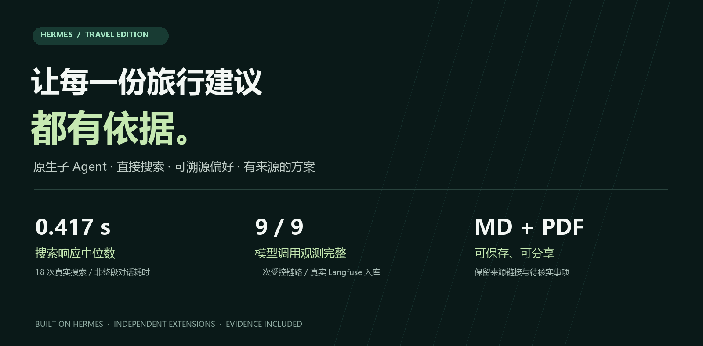
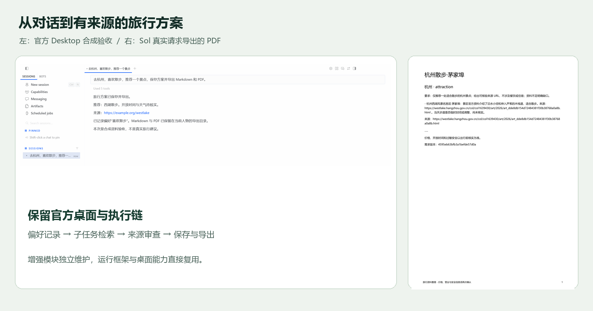
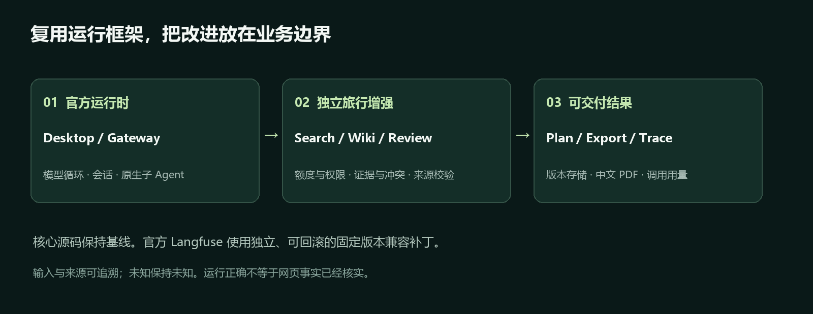

<div align="center">



# Hermes Travel

**在 Hermes 原生桌面上，把偏好、搜索证据与旅行方案连接起来。**

原生子 Agent · 直接 HTTP 搜索 · 可溯源 Wiki · 来源审查 · Markdown / PDF · Langfuse

[查看效果](#看看实际效果) · [快速开始](#快速开始) · [实测数据](#数据说了什么) · [架构与改进](#复用什么改进什么) · [发布说明](docs/travel/RELEASE-v1.0.0.md)

**Windows 源码发布版 v1.0.0** · **MIT** · **默认 gpt-6-sol**

</div>

---

## 让旅行建议有迹可循

输入“去杭州，长期喜欢散步，推荐一处景点，保留来源并导出方案”。Hermes 记录有原话依据的偏好，派出只允许搜索的原生子 Agent，审查候选与来源，最后保存可追溯的方案。

这个项目关注三个具体问题：**搜索链路太绕、偏好记忆难追溯、最终方案容易丢来源**。完整保留 Hermes 官方运行时与桌面，将增强集中在独立模块；不另造 Agent 框架。

| 能力 | 你能得到什么 |
| --- | --- |
| **直接搜索** | 豆包 HTTP API 通过 Hermes 原生 provider 使用，无额外 MCP 或 Claude Code 搜索进程 |
| **人物偏好 Wiki** | 原话 → 事实 → Wiki 页面，来源可查，冲突保留，确认权交给用户 |
| **受限子 Agent** | 美食、住宿、景点三个方向；只允许搜索，支持取消、额度与需求过期检查 |
| **资料审查** | 候选必须引用实际检索结果，资料不足明确保留缺口 |
| **方案交付** | 版本存储、Markdown 与中文 PDF 导出，直接保留审查后的来源 |
| **执行观测** | 官方 Langfuse 加固定版本兼容补丁，记录主任务、子任务、工具和旅行审查用量 |

## 看看实际效果



左侧是**真实官方 Desktop/Gateway，模型和搜索资料为合成验收数据**；右侧是 **Sol 中转真实请求生成的 PDF**。展示图经过裁切与排版，未伪造界面或模型输出。

[完整桌面截图](docs/travel/images/desktop-travel-v4.png) · [真实 Markdown](docs/travel/examples/travel-live-sol-v1.md) · [真实 PDF](docs/travel/examples/travel-live-sol-v1.pdf) · [真实调用回执](docs/travel/data/relay-sol-live-20261018.json)

## 数据说了什么

| 观察 | 实测结果 | 测量边界 |
| --- | --- | --- |
| 直接搜索响应 | **18/18 成功 · 中位 0.417s · P95 1.181s** | 6 条查询各 3 次，只测接口；不代表整段对话耗时 |
| 一次 Sol 真实旅行请求 | **64.981s · 10 次模型请求 · 1 次搜索** | 生成偏好、方案及 MD/PDF；单次完成不是稳定性或质量统计 |
| 偏好写入完整性 | **4/4 合成错误写入被拒绝** | 验证证据与规则，不冒充模型幻觉率降低 |
| 修复后的真实观测入库 | **9/9 模型调用 · 18 条观测 · 0 条错误观测** | 模型/搜索为固定响应，本地 Langfuse 为真实服务；合成 usage 合计 360 token |
| 同机干净安装 | **42/42 基线回归通过** | 独立运行目录，未复制密钥；不是跨平台或新机器验收 |
| 发布版增强回归 | **45/45 通过** | 覆盖旅行与观测修复；另通过 142 项官方 Langfuse 回归，不代表全量上游测试 |

[搜索对比与方法](docs/travel/02-豆包搜索.md) · [Wiki 完整性对照](docs/travel/05-Wiki偏好.md) · [观测修复前后](docs/travel/07-Langfuse.md) · [安装与模型证据](docs/travel/08-模型选型与发布.md)

> 没有同条件旧搜索链路数据，因此不宣称提速多少倍。Sol 单次请求返回 50,971 token，**中转费用未知**；不能套用旧 DeepSeek 价格，也不能据此推算日常成本。

## 快速开始

已验证：**Windows + PowerShell 7 + Git + Node.js 24**。Python 与后端依赖由 Hermes 官方 PM 管理；中文 PDF 使用系统微软雅黑。先克隆本仓库，进入仓库根目录，再执行：

```powershell
$env:UV_INDEX_URL = 'https://pypi.org/simple'
pwsh.exe -NoLogo -NoProfile -NonInteractive -ExecutionPolicy Bypass -File ./travel_extensions/setup.ps1
```

在本机 `.hermes-runtime/profile/.env` 填入自己的凭据（[完整空模板](travel_extensions/.env.example)）：

```dotenv
CUSTOM_API_KEY=你的中转站密钥
ASK_ECHO_SEARCH_INFINITY_API_KEY=你的搜索密钥
```

默认主任务、子任务和审查均使用 **`https://ccgoai.club/v1` → `gpt-6-sol`**。模型与地址集中在 [配置模板](travel_extensions/config.travel.example.yaml)，密钥不写入 YAML。模型请求会发往该第三方中转站，搜索查询会发往 `open.feedcoopapi.com`；使用前确认自己接受其服务与计费方式。本项目不附带 API 额度。

```powershell
# 安装官方桌面依赖并启动
npm ci --no-audit --no-fund
pwsh.exe -NoLogo -NoProfile -ExecutionPolicy Bypass -File ./travel_extensions/start.ps1 -Desktop

# 或直接使用终端
pwsh.exe -NoLogo -NoProfile -ExecutionPolicy Bypass -File ./travel_extensions/start.ps1
```

可以从这句话开始：

> 去杭州，我长期喜欢散步。推荐一处独立景点，说明未核实的事项，保留来源，保存方案并导出 Markdown 和 PDF。

| 内容 | 默认保存位置 |
| --- | --- |
| 运行配置与凭据 | `.hermes-runtime/profile/` |
| 偏好原话、事实与 Wiki | `.hermes-runtime/profile/travel/wiki/` |
| 方案导出 | `.hermes-runtime/profile/travel/exports/` |

一个 profile 对应一个人物，不给不同用户共用。偏好冲突时，使用 `/确认偏好 <id>`；`/忘记偏好 <id>` 将事实移出后续上下文，**不是物理删除原话或审计记录**。详见 [Wiki 使用说明](docs/travel/05-Wiki偏好.md)。

<details>
<summary><strong>可选：接入本地 Langfuse</strong></summary>

旅行功能不依赖 Docker 或 Langfuse。需要观测时，先准备自己的本地 Langfuse 服务，再执行：

```powershell
pwsh.exe -NoLogo -NoProfile -NonInteractive -ExecutionPolicy Bypass -File ./travel_extensions/setup.ps1 -WithLangfuse
```

该选项安装固定提交的官方插件，并应用独立兼容补丁；仅设置自己的本地服务 URL、公私钥。现有非固定版本会被拒绝修改，不静默覆盖。补丁用途、脱敏、真实入库证据和回滚命令见 [观测说明](docs/travel/07-Langfuse.md)。

</details>

## 复用什么，改进什么



**运行框架是上游的，业务改进是独立的。** 官方模型循环、原生子任务生命周期、Gateway 和 Desktop 均保留。Langfuse 继续使用官方 SDK、客户端与脱敏逻辑，只应用可审阅、可回滚的兼容补丁。

| 改进 | 为什么加 | 新增位置与证据 |
| --- | --- | --- |
| 直接搜索 provider | 减少外部执行器环节，单独测量搜索耗时 | [doubao_search](travel_extensions/doubao_search/) · [18 次实测](docs/travel/02-豆包搜索.md) |
| 原生研究与来源审查 | 沿用取消和调度，补旅行额度、权限、时效及来源约束 | [research.py](travel_extensions/travel/research.py) · [受限子 Agent](docs/travel/03-原生子Agent.md) · [审查测试](docs/travel/04-旅行审查.md) |
| Wiki 事实与规则层 | 单个记忆文件不提供逐事实证据、冲突保留和写入约束 | [wiki.py](travel_extensions/travel/wiki.py) · [完整性对照](docs/travel/05-Wiki偏好.md) |
| 审查结果直接导出 | 避免额外模型改写造成来源遗漏 | [plans.py](travel_extensions/travel/plans.py) · [中文导出验证](docs/travel/06-方案与桌面.md) |
| 观测兼容修复 | 修复子搜索状态误报和独立审查漏记 | [固定版本补丁](travel_extensions/observability/patch_langfuse.py) · [前后回执](docs/travel/07-Langfuse.md) |

LLM Wiki **仅部分复用文件规范与组织思路**，来源为 [nashsu/llm_wiki](https://github.com/nashsu/llm_wiki/tree/48fd970e206a02a6d2028d1dbfc41b7a0345bf0b)。没有运行第二个 Tauri 应用，也没有复制 GPLv3 实现；事实表与规则由本项目独立实现。它提升可追溯性与写入约束，不保证模型永不出错。

```text
travel_extensions/
├── doubao_search/      # 直接 HTTP 搜索 provider
├── travel/            # Wiki、研究、审查、方案与原生 hook
├── observability/     # 官方 Langfuse 固定版本兼容补丁
├── verification/      # 搜索实测、桌面验收、回执与发布检查
├── configure.py       # 独立 profile 配置
├── setup.ps1          # 官方 PM 安装与插件检查
└── start.ps1          # 终端 / 官方桌面入口
tests/travel_extensions/ # 边界、回归与原生父子集成测试
docs/travel/             # 逐项设计理由、数据、图片和输出样例
```

## 项目进度与选型记录

此处是当前状态唯一入口；[原迁移计划](迁移计划-v1.md)保留历史范围。

| 阶段 | 当前状态 | 实现与验证 |
| --- | --- | --- |
| 1. 官方运行时与 Desktop | 已完成 | [基线说明](docs/travel/01-官方基线.md)：构建与 113 项相关桌面测试通过 |
| 2. 豆包直接搜索 | 已完成 | provider 协议、工具注册、真实接口测量 |
| 3. 原生子 Agent | 已完成 | 三方向任务，搜索白名单，取消、隔离与过期检查 |
| 4. 旅行资料审查 | 已完成 | 五次额度、两轮修正、实际来源白名单 |
| 5. 人物偏好 Wiki | 已完成 | 原话来源、冲突确认、格式投影与软删除 |
| 6. 方案与桌面交付 | 已完成 | 实际 Desktop/Gateway 全流程，MD/PDF 导出 |
| 7. Langfuse 观测 | 已修复并复验 | 9/9 调用记录，子搜索正常闭合，审查计入 usage |
| 8. 发布准备 | 本地待审阅 | Sol 配置、安装验证、展示图片、许可证、数据与检查脚本；未 push |

| 选择 | 理由、取舍与实现状态 |
| --- | --- |
| Hermes `ccc6956` 完整源码 + 独立模块 | 官方负责运行框架与桌面；保留基线标签及差异，不搬旧框架 |
| 豆包直接 API，原生 `WebSearchProvider` | 无需 MCP；移除旅行业务对 Claude Code 与高德的依赖，上游通用集成保留 |
| 原生生命周期 + 旅行薄适配 | 复用创建、等待、取消；自写额度、来源、人物/会话约束 |
| LLM Wiki 文件规范部分复用 | 不另开应用；独立事实与规则层，许可边界明确 |
| 官方 Langfuse 2.0.0 + 版本锁定补丁 | 真实验收发现两项缺口后最小修复；沿用客户端和脱敏，非另建上报系统 |

## 验证与维护

```powershell
$env:HERMES_HOME = Join-Path $PWD '.hermes-runtime/profile'
$env:HERMES_RUNTIME_DIR = Join-Path $PWD '.hermes-runtime/tools'
. ./activate.ps1 -TestExtras web
bash scripts/run_tests.sh tests/travel_extensions -q -j 3
python -m travel_extensions.verification.check_release
```

Langfuse 专项测试需要先安装可选插件；未安装时明确跳过，不算通过。真实 API 脚本会产生费用，不包含在默认回归中。已通过的本机检查不等于远程 GitHub CI；上游 workflows 含官方组织专用环境，Fork 后须审阅再启用。

查看全部增强差异：

```bash
git diff travel-upstream-baseline-20261018 -- travel_extensions tests/travel_extensions docs/travel README.md
```

## 使用边界

- 整理旅行资料，不支持订票、付款、预订或地图路线计算；价格、营业时间和安全信息须临行核实。
- 中转返回的模型标识不等于已独立核实底层模型身份。中转单价未知，Langfuse 展示 token 不代表账单实扣。
- 新用户消息使旧研究任务过期，包括“继续”；这是当前保守的防串需求策略。
- 主子任务为官方两条 trace，通过子会话关联；不是统一单树。只补旅行审查观测，不宣称覆盖所有辅助模型服务。
- 官方观测没有持久离线发送队列，服务故障时可能丢记录；不阻塞旅行回答。
- 当前交付为 Windows 源码版，不是已签名安装包。未验证 Linux/macOS 的安装与中文 PDF。

## 来源与许可

[Hermes Agent](https://github.com/NousResearch/hermes-agent) · [官方 Langfuse 插件](https://github.com/NousResearch/hermes-official-plugins/tree/c2a95963c442f3f23e4bc6fe0da898e1dd1fb63d/langfuse) · [LLM Wiki](https://github.com/nashsu/llm_wiki)

本项目遵循 [MIT License](LICENSE)。保留上游版权；原版介绍见 [固定版本 README](https://github.com/NousResearch/hermes-agent/blob/ccc695635094d7615373db267b77f894d978b1a0/README.md)。[第三方复用与补丁说明](docs/travel/THIRD-PARTY.md)明确区分直接复用、规范参考与自写部分。
