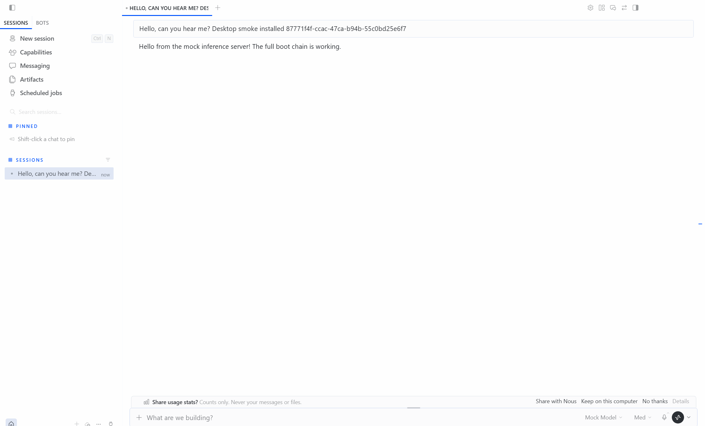

# 01 · 保留官方运行时与桌面

旅行增强运行在 Hermes 官方源码上。官方负责模型循环、会话、工具执行、子任务和桌面，自有插件补旅行能力。

## 为什么这样选

原项目绑定旧版 Hermes，并包含 Claude Code 搜索进程、桌面接入和独立观测适配。直接搬入外围代码会继续维护已被新版原生能力覆盖的路径。因此先验证官方基线，再逐个补缺口。

固定基线：`ccc695635094d7615373db267b77f894d978b1a0`。标签 `travel-upstream-baseline-20261018`。浅克隆包含当前完整源码，Git 历史尚未补全。没有修改上游业务源码。

## 数据与验证

2026-10-18，Windows，Python 3.14.7，Node 24.19.0：

| 检查 | 结果 | 能证明什么 |
| --- | --- | --- |
| 官方 setup，RuntimeOnly + TestExtras web | 成功 | 应用与测试依赖安装 |
| 原生 CLI --version | 成功，指向新 checkout | 没有误用旧 Hermes |
| npm ci --no-audit --no-fund | 成功，1341 个包 | 锁文件安装 |
| npm run build --workspace apps/desktop | 成功 | 原版 Electron 与前端可构建 |
| 工具摘要、聊天消息、会话 API 三组 Vitest | 113 / 113 通过 | 相关桌面逻辑回归 |
| 委派能力继承、Gateway 子任务生命周期 | 17 / 17 通过 | 原生委派的部分边界回归 |
| 隐藏 Desktop → 原生 Gateway → 模拟模型 → 桌面回复 | 通过，窗口不可见 | 实际后端启动、请求发出、完成回复回显；不代表真实模型质量 |



后台测试使用英文 UI，因为官方聊天 helper 以英文 aria-label 判定完成；最初中文 UI 已收到回复，但完成按钮匹配失败。仅修正测试环境语言，未改应用业务代码。

镜像缺少 pilk==0.2.4 上传时间，触发官方 PM 发布时间策略；切换官方 PyPI 后完成安装，没有改源码或放宽版本策略。

## 复现

```powershell
$env:HERMES_HOME = Join-Path $PWD '.hermes-runtime/profile'
$env:HERMES_RUNTIME_DIR = Join-Path $PWD '.hermes-runtime/tools'
$env:UV_INDEX_URL = 'https://pypi.org/simple'
pwsh.exe -NoLogo -NoProfile -NonInteractive -ExecutionPolicy Bypass -File ./setup-hermes.ps1 -RuntimeOnly -TestExtras web
npm ci --no-audit --no-fund
npm run build --workspace apps/desktop
```

Python 测试使用 [官方 runner](../../scripts/run_tests.sh)，把 PM 测试解释器传入 HERMES_PYTHON。桌面后台验收脚本 [desktop-smoke.ts](../../travel_extensions/verification/desktop-smoke.ts) 复用官方 mock server 和聊天验收 helper；TRAVEL_TEST_PYTHON 指向 PM 应用解释器。使用合成对话，窗口保持隐藏，不调用真实模型。

官方代码：[Desktop](../../apps/desktop)、[共享前端](../../apps/shared)、[子 Agent](../../tools/delegate_tool.py)。这些都是复用，不是本项目新增功能。
