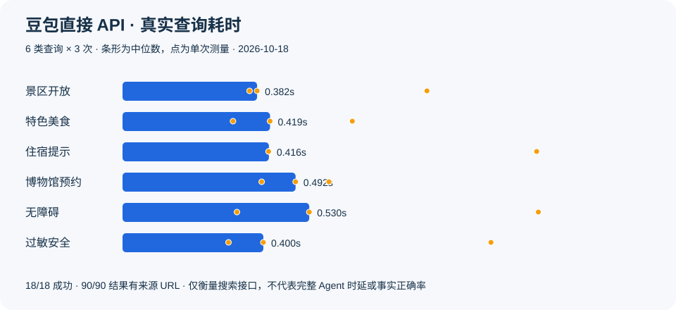

# 02 · 直接接入豆包搜索

Hermes 主/子 Agent 继续调用原生 `web_search`，独立 provider 将它转换成一次带 Bearer 鉴权的 HTTP 请求。无需 Claude Code 或 MCP 进程。

## 问题与选择

用户在旧项目中观察到子任务搜索慢，试用豆包搜索后认为响应更快。这是选型动机，不是本轮实验结论。旧链路还包含外部 CLI 启动、模型决策和多轮工具调用，不能把全部耗时都归因于搜索引擎。

核查后确认采用独立 [联网搜索 API](https://docs.volcengine.com/docs/Networkedsearch/Networkedsearch-2?lang=zh)，而不是 Agent Plan 或模型内置联网能力：

- 请求 `https://open.feedcoopapi.com/search_api/web_search`，支持查询、结果数量、时间/站点过滤等能力。
- 本项目只接入当前所需的 Query、Count、来源 URL、摘要；默认不做 QueryRewrite、不抓完整正文，不把供应商全部能力标成已实现。
- 优先返回 Summary，缺失时用 Snippet；保留原始 URL。标题为空可容忍，没有可用来源则不当作有效资料。
- 30 秒超时，失败不自动重试，避免隐性增加费用；错误信息不回显服务端原文或密钥。

| 候选 | 选择 |
| --- | --- |
| 直接 HTTP + 官方 WebSearchProvider | 采用。一个插件、一个请求，复用原生工具和 profile 凭据隔离 |
| 官方豆包 MCP | 已探索但不用于运行。它最终也是请求同一 API；本需求无需增加服务进程和协议依赖 |
| 继续 Claude Code 搜索进程 | 不迁移。用户已选择 Hermes 原生子 Agent |

## 数据：真实搜索，非完整 Agent 对话

2026-10-18，同一台 Windows、同一网络，6 类合成查询 × 3 次，共 18 次；每次请求 5 条、关闭查询重写。每次真实调用 provider，没有使用 Hermes 搜索结果缓存。

| 指标 | 实测 |
| --- | --- |
| API 成功 | 18 / 18 |
| 返回结果 | 90 条；每次 5 条 |
| 保留有效来源 URL | 90 / 90 |
| 中位耗时 | 0.417 秒 |
| P95，最近秩法 | 1.181 秒 |
| 估算费用 | 0.36 元（0.020 元/次），实扣未读取 |

原始公开数据：[18 次测量](data/search-direct-20261018.json)。合成查询：[search-cases.json](../../travel_extensions/verification/search-cases.json)。复测：配置隔离 profile 与密钥后，运行 `python -m travel_extensions.verification.benchmark_search --live --output <新文件名.json>`，会产生 18 次搜索费用。

来源 URL 完整不等于内容真实或满足旅行条件，后续旅行审查负责进一步验证。此样本没有同条件的旧 Claude 链路数据，不给出“比以前快 X 倍”。MCP 曾单次测得冷启动 4.597 秒、查询 0.353 秒，条件不配对，仅作为探索记录，不能据此判定稳定速度差。

## 新增在哪里

- [provider.py](../../travel_extensions/doubao_search/provider.py)：鉴权、请求、字段转换与错误处理。
- [plugin.yaml](../../travel_extensions/doubao_search/plugin.yaml) 和 [注册入口](../../travel_extensions/doubao_search/__init__.py)：官方 backend 插件协议。
- [18 项协议测试](../../tests/travel_extensions/test_doubao_search.py)、[真实发现链路测试](../../tests/travel_extensions/test_doubao_discovery.py)：共 19 项通过；后者通过官方插件发现调用原生工具，HTTP 使用 fixture。
- 官方 `plugins validate` 与 `plugins doctor` 均通过；未修改上游 WebSearchProvider、web_search 或委派代码。
- 安装到隔离 profile 后，原生 `web_search_tool` 真实调用返回 5 条结果，选中的 provider 确认是 doubao。加上早先 MCP 探索 1 次和该次集成验证，本轮累计 20 次搜索，估算 0.40 元，实扣未知。

## 配置

按官方目录插件方式，将 `travel_extensions/doubao_search` 放入隔离 profile 的 `plugins/web/doubao_search`，在 config.yaml 启用 `plugins.enabled: [web-doubao]`，选择 `web.search_backend: doubao`。凭据 `ASK_ECHO_SEARCH_INFINITY_API_KEY` 只放该 profile 的 `.env`，不入库。无凭据时不可用，不发网络探测。

原版扩展点：[固定版本源码](https://github.com/NousResearch/hermes-agent/blob/ccc695635094d7615373db267b77f894d978b1a0/agent/web_search_provider.py)。新增文件在原版中不存在；对照命令：`git diff travel-upstream-baseline-20261018 -- travel_extensions/doubao_search`。
