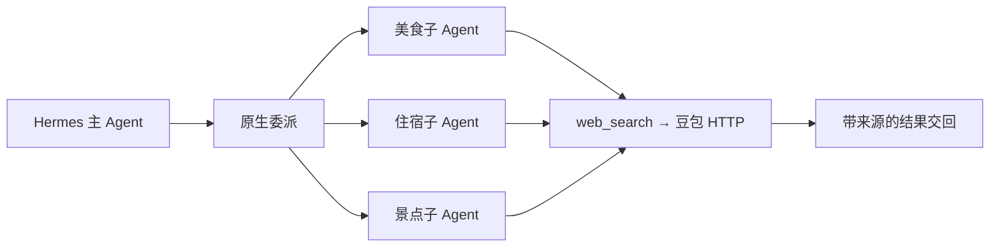

# 原生子 Agent：先验证运行链路

旧项目通过外部 Claude Code 搜索执行器处理任务。现在直接使用固定版本 Hermes 的 `delegate_task`、子 Agent 构造与生命周期；豆包只是原生 `web_search` 的后端。

## 实测边界

`tests/travel_extensions/test_native_children.py` 用真实 AIAgent、原生委派和插件发现启动三个子 Agent。模型与搜索网络响应为固定资料：3/3 完成、6 次模型对话请求，每个请求工具列表严格只有 `web_search`。没有 Claude 进程，也没有重新实现 Agent 循环。

另有上游生命周期 15 项、容量与中断 13 项测试通过。这些是协议与受控运行验证，不是付费模型效果或速度测试。模型元数据探测不计入对话请求。

配置样例见 [config.search-only.example.yaml](../../travel_extensions/config.search-only.example.yaml)。深度限制为 1、并发为 3、关闭 MCP 工具继承。此配置只适用于父 Agent 也只有搜索与委派的阶段；加入 Wiki/方案工具后，应改用公开 `ctx.subagent_lifecycle.launch(allowed_toolsets=("search",))`，不能假设所有父工具都会自动排除。

## 复用与差异

- 原版完整实现：[delegate_tool.py](https://github.com/NousResearch/hermes-agent/blob/ccc695635094d7615373db267b77f894d978b1a0/tools/delegate_tool.py)、[公开生命周期](https://github.com/NousResearch/hermes-agent/blob/ccc695635094d7615373db267b77f894d978b1a0/agent/subagent_lifecycle.py)。
- 本阶段只添加配置与验收测试，核心源码未改。
- 搜索次数限额、旅行审查和陈旧结果隔离仍在后续业务阶段实现；不能把模型轮次当作搜索次数。
- 进程退出后恢复聊天不等于恢复仍在执行的子 Agent。
