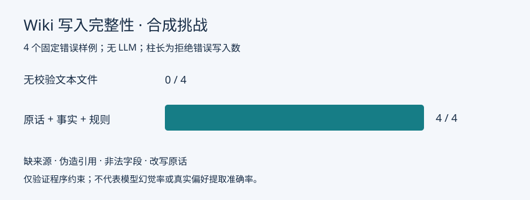

# 偏好 Wiki：原话、事实与规则分层

同一份可编辑记忆文件适合记录简单摘要，但文件本身不校验“这句话是谁说的”“引用是否存在”“新偏好是否覆盖了旧偏好”。因此增加三个层次：Raw 保存用户原话，事实表保存引用和状态，Schema 约束字段与更新。Wiki Markdown 是可恢复的阅读视图。

## 部分复用，具体复用了什么

用户指定的 [LLM Wiki 中文说明](https://github.com/nashsu/llm_wiki/blob/48fd970e206a02a6d2028d1dbfc41b7a0345bf0b/README_CN.md) 提供 Raw/Wiki/Schema、`purpose.md`、来源 frontmatter、索引与 lint 的组织思路。本项目采用这些文件约定，**独立实现 Python 事实存储与 Hermes hooks，未复制 GPLv3 Rust/TypeScript 模块**。不运行 LLM Wiki 应用或 HTTP 服务，不声称接入其全部功能。

2026-10-18 核查仓库 20,732 Star；所读提交 `48fd970e…`，最新已发布 v0.6.12（2026-09-28）。许可为 GPLv3，因此没有把应用代码直接混入 Hermes MIT 源码。固定提交用于设计溯源，不等同于运行该版本。

Hermes 原版已有 [MemoryProvider](https://github.com/NousResearch/hermes-agent/blob/ccc695635094d7615373db267b77f894d978b1a0/agent/memory_provider.py) 与 [hooks](../../website/docs/user-guide/features/hooks.md)。当前使用公开 `pre_llm_call` 动态注入，避免每轮重建系统提示；保留原生运行框架。新增 [wiki.py](../../travel_extensions/travel/wiki.py) 和 [integration.py](../../travel_extensions/travel/integration.py)。旧项目页面级 Wiki 的整页替换无法提供逐事实冲突状态，因此此处改为事实表，而非搬运旧编排器。

## 使用方式

每个 Hermes profile 对应一个人物。不要让两个不同人物共享一个 profile。用户说“我不吃辣”，模型可提交逐字引用“我不吃辣”或“不吃辣”；程序验证来源属于当前会话、引用真实存在、字段在 Schema 中。

后续说“现在吃微辣”，同一字段不同原话保留为 `conflict`，不静默覆盖。用户输入 `/确认偏好 <事实ID>` 选择当前偏好；`/忘记偏好 <事实ID>` 从注入上下文移除。**忘记是软删除，Raw/审计仍保留**；完全删除需关闭该 profile 后删除其 `travel/wiki` 数据目录。

网页、子 Agent 回答不会被录成用户原话。模型没有确认冲突或改写 Raw 的工具。数据保存在 `$HERMES_HOME/travel/wiki/`；Markdown 手工修改会被 lint 检出，再由 SQLite 事实日志重建。不要把私人目录提交到 Git。

## 数据与限制

7 项测试通过：无来源/伪造引用/非法字段/改写原话拒绝，冲突确认、重复写入、12 路并发幂等、跨人物隔离、重启读取、视图修复，以及真实插件发现和 hook 注入。

[原始数据](data/wiki-integrity-20261018.json)来自 4 个**人工构造的错误写入**：无校验文本文件拦截 0/4，本实现拦截 4/4；冲突两条均保留。复现：`python -m travel_extensions.verification.compare_wiki <新的输出.json>`。这不是对 Hermes 原生 memory 工具的完整对比，也不是“模型幻觉下降 100%”。

程序可保证引用存在，不能保证引用被正确理解。截取“我不喜欢辣”中的“喜欢辣”仍可能产生语义错误；不同表达也可能被保守地判为冲突。没有用确定性写入测试代替真实模型效果评估。当前按需提示模型提取长期偏好，不保证每条自然语言都自动提取成功。
