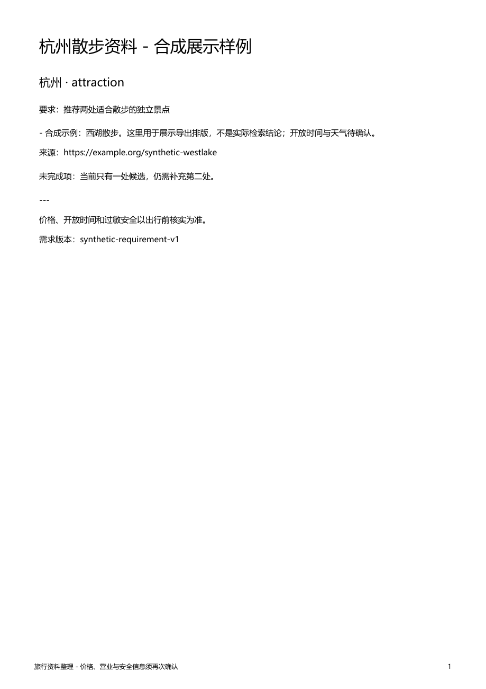

# 方案版本、导出与原生桌面

`travel_plan` 将已经审查的候选保存成会话内的版本，导出 Markdown 和中文 PDF。界面直接复用官方 Desktop，未增加另一套前端。


## 为什么加

旧项目真实 DeepSeek 联网样例曾遗漏来源 URL。即使审查阶段保留来源，再让模型自由改写保存正文，也可能在最后一步丢失链接。因此 [plans.py](../../travel_extensions/travel/plans.py) 直接用已审查候选构建正文，逐项保留来源、需求版本与未完成项。它改善保存产物的完整性，不能保证模型聊天回复每次都正确。

复用旧项目的 SQLite 版本管理与 ReportLab 导出思路；移除旧观测 worker、外部虚拟环境兜底和独立人物路由。宿主负责会话归属，插件补三项职责：审查结果校验、版本快照、文件导出。ReportLab 当前实装 4.5.1，由 Hermes PM 管理。

## 验证与边界

2026-10-18，4 项方案测试通过：幂等保存、历史版本、来源与缺口保留、跨会话/过期/取消/未审查拒绝、重复导出不覆盖，以及 PDF 生成失败时不发布半份 Markdown。每次导出生成带版本、时间戳和随机后缀的新文件。两文件发布不构成跨文件系统事务，磁盘故障不在本轮故障注入范围内。

另一个真实 AIAgent 集成用例覆盖父 Agent、子 Agent、hook、审查、Wiki、保存和 Markdown 导出；直接绕过旅行任务搜索会被拒绝。网络使用本地固定响应，不付费。

真实隐藏 Electron/Gateway 验收完成一次完整请求，共 9 次模拟模型请求，其中子 Agent 2 次、审查 1 次，生成 Markdown/PDF 各 1 份。检查窗口始终不可见，最终回复在官方桌面渲染。见[脱敏回执](data/desktop-travel-20261018.json)和[验收脚本](../../travel_extensions/verification/desktop-travel.ts)。这不是 DeepSeek 的真实质量或延迟测试。



[PDF 展示样例](examples/travel-example-v2.pdf)与[Markdown](examples/travel-example-v2.md)使用虚构资料，已检查一页 PDF 的中文、完整来源 URL 和缺口说明。原版文件保存在 `examples/旧版/`。生成脚本为 [export_example.py](../../travel_extensions/verification/export_example.py)。

当前 PDF 使用本机 Windows 微软雅黑字体；缺少字体会明确报错。没有验证 Linux/macOS PDF，不随项目分发字体。桌面能展示工具执行与回复，但本轮没有承诺新增可点击下载按钮；导出文件路径由工具返回，存放在当前 profile 的 `travel/exports/`。

## 复现

先按根 README 安装。设置 `TRAVEL_TEST_PYTHON` 为 PM 应用解释器后运行：

```powershell
node --experimental-strip-types travel_extensions/verification/desktop-travel.ts
```

脚本创建独立 profile，只使用合成模型与资料。已有截图会拒绝覆盖；重复验收先设置新的 `TRAVEL_SCREENSHOT_VERSION`。Python 回归使用官方 `scripts/run_tests.sh tests/travel_extensions -q -j 3`。

官方原版完整源码：[Desktop](https://github.com/NousResearch/hermes-agent/tree/ccc695635094d7615373db267b77f894d978b1a0/apps/desktop)。新增功能源码：[plans.py](../../travel_extensions/travel/plans.py)、[integration.py](../../travel_extensions/travel/integration.py)；可通过基线标签查看完整差异，无需在文档复制两份会过期的源码。
