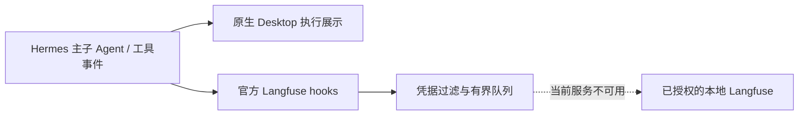

# 官方 Langfuse：安装与验收边界

直接安装官方 `langfuse` 2.0.0 插件，固定 [c2a95963…](https://github.com/NousResearch/hermes-official-plugins/tree/c2a95963c442f3f23e4bc6fe0da898e1dd1fb63d/langfuse)。Hermes PM 管理其 `langfuse==4.15.2` 依赖。没有复制旧项目观测 worker，没有自写事件转发器。

## 已完成

- 官方清单固定提交安装，并由 PM 完成 SDK 依赖准备；插件已启用。
- 只配置原项目已经授权的本地地址与凭据，配置保存在忽略目录。没有云端发送、历史回填或隐藏思考采集。
- 固定版本插件自带测试在本 checkout 通过 **143 项**，覆盖 opt-in、请求与工具归属、子 Agent 关联、关闭、失败、脱敏、内容深度与 profile 凭据隔离。测试使用模拟 SDK，不能替代真实服务入库。

复现：安装官方插件后，使用 `scripts/run_tests.sh <HERMES_HOME>/plugins/langfuse/tests -q -j 3`。不要修改插件源码来适应观测需求；升级时重新固定版本并跑其测试。

## 当前阻塞

本地 Docker Engine 未运行。后台启动尝试的日志显示 `initializing Inference manager` 失败，原因是 `dockerInference` 监听文件无法访问；没有执行 Docker 重置、重装或数据清理。因此**尚未完成新版本到真实本地 Langfuse 的 trace 入库验收**，README 不标为完整完成。

服务恢复后最小验收：只发送一条合成旅行请求，核对主回合、子 Agent、web_search 和无工具审查的父子关系、用量及内容脱敏。旧项目历史 trace 不用于证明这次新插件已经上报。

固定 Hermes 版本从父工具启动原生子 Agent 时，子工具的 `post_tool_call` 存在 observer suppression；旅行证据已使用公开结果转换 hook 接通，但官方 Langfuse 使用的观测 hook 是否包含这条路径的完整工具 span，仍需真实检查。143 项插件模拟测试不能证明这一点。

其他机器复现：在旅行 profile 内执行 `python -m hermes_cli.main plugins install langfuse`，核对安装回执 `.hermes-catalog.json` 的版本；清单以后可能更新，版本不同须重测。将 `HERMES_LANGFUSE_BASE_URL` 配为自己的本地服务，公私钥仅填当前 profile 的 `.env`；`HERMES_LANGFUSE_CAPTURE=sanitized`。本项目没有为其他用户默认填写云地址或启用遥测。

官方插件在服务不可用时不阻塞回答；但它没有持久化离线发送队列，进程退出或发送失败可能丢失观测。这是原生插件的取舍，不额外造一个上报系统。
