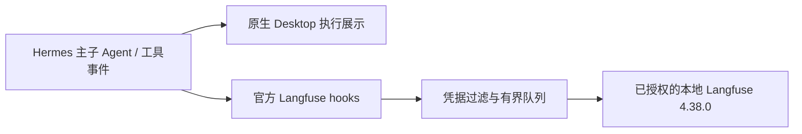

# 官方 Langfuse：安装与验收边界

直接安装官方 `langfuse` 2.0.0 插件，固定 [c2a95963…](https://github.com/NousResearch/hermes-official-plugins/tree/c2a95963c442f3f23e4bc6fe0da898e1dd1fb63d/langfuse)。Hermes PM 管理其 `langfuse==4.15.2` 依赖。没有复制旧项目观测 worker，没有自写事件转发器。

## 已完成

- 官方清单固定提交安装，并由 PM 完成 SDK 依赖准备；插件已启用。
- 只配置原项目已经授权的本地地址与凭据，配置保存在忽略目录。没有云端发送、历史回填或隐藏思考采集。
- 固定版本插件自带测试在本 checkout 通过 **143 项**，覆盖 opt-in、请求与工具归属、子 Agent 关联、关闭、失败、脱敏、内容深度与 profile 凭据隔离。测试使用模拟 SDK，不能替代真实服务入库。

复现：安装官方插件后，使用 `scripts/run_tests.sh <HERMES_HOME>/plugins/langfuse/tests -q -j 3`。不要修改插件源码来适应观测需求；升级时重新固定版本并跑其测试。

## 真实服务验收：入库成功，完整观测未通过

2026-10-18 已在同一次停止 Docker 后，备份并重建 `Docker/run` 和 `docker-secrets-engine` 两处 socket 目录。仅处理前者会在 Secrets Engine 再次失败；随后单独处理后者又会遇到前次启动留下的 Inference socket。两处同时处理后，`docker info` 返回 Engine 29.6.1，原有 Langfuse 七个容器恢复，健康接口返回 `OK`。未删除镜像、容器或数据卷。这是本机恢复措施，尚未确认残留文件反复出现的底层原因。

使用官方隐藏 Desktop/Gateway、真实父子 Agent 与官方观测插件发送一条合成旅行请求；模型与搜索响应固定，无新增付费模型调用。Wiki → 搜索 → 审查 → Markdown/PDF 完成，9 次模型请求中包含 2 次子 Agent 请求和 1 次审查。

通过 Langfuse v4 的 `/api/public/v2/observations` 查询本次指定 trace，得到 **2 条 trace、17 条 observation、8 条 generation**。[脱敏回执](data/langfuse-live-20261018.json)只保留名称、类型、关联、用量和状态，不导出原始对话或凭据。旧 `/api/public/traces` 在该服务 `events_only` 模式不可用，不应把旧查询失败误判为未入库。

| 核对项 | 实际结果 |
| --- | --- |
| 主任务与原生子任务 | 主 trace 有 `Subagent: leaf` 完成记录，metadata 的子 session 可对应子 trace；不是同一条 trace 的完整树 |
| 搜索工具 | 子 Agent 实际成功，生命周期历史为 `status=ok`；工具 span 却为 ERROR，提示回合结束前未收到结果 |
| 模型用量 | 主任务 6 次、子任务 2 次，每次合成 usage 为 40 token；独立审查的 1 次调用没有 generation |
| 导出 | Markdown/PDF 各 1 份，桌面仍正常完成 |
| 脱敏 | 本次未发送真实密钥给模型；内容脱敏行为另由官方 143 项模拟测试覆盖，未把此处当作新增攻击测试 |

根因依据：`agent/tool_executor.py` 对父工具设置 `model_tools.suppress_post_tool_call_hook()`，子任务继承上下文；官方插件只通过 `post_tool_call` 完成工具 span，最终在 `_end_children` 将未闭合调用标为 ERROR。旅行证据通过公开 `transform_tool_result` 正常保存，所以这是观测错误，不是搜索失败。独立辅助模型使用专门的 auxiliary hooks，而固定版本插件只注册普通 LLM hooks，因此漏记审查调用。保留官方插件与 Hermes 源码不改，**不能据此看板统计完整成本或搜索错误率**。

复现：设置 `TRAVEL_LANGFUSE_PROFILE` 为已配置本地凭据且安装官方插件的 profile，`TRAVEL_TEST_PYTHON` 为当前 PM 应用解释器，`TRAVEL_SCREENSHOT_VERSION` 为未使用的新数字，再运行 `node --experimental-strip-types travel_extensions/verification/desktop-travel.ts`。默认不设置 profile 时不发送观测。用 [langfuse_receipt.py](../../travel_extensions/verification/langfuse_receipt.py) 的 `--env-file`、重复 `--trace-id` 与新 `--output` 路径查询指定验收记录。仅允许 loopback 服务，拒绝覆盖旧回执。

其他机器复现：在旅行 profile 内执行 `python -m hermes_cli.main plugins install langfuse`，核对安装回执 `.hermes-catalog.json` 的版本；清单以后可能更新，版本不同须重测。将 `HERMES_LANGFUSE_BASE_URL` 配为自己的本地服务，公私钥仅填当前 profile 的 `.env`；`HERMES_LANGFUSE_CAPTURE=sanitized`。本项目没有为其他用户默认填写云地址或启用遥测。

官方插件在服务不可用时不阻塞回答；但它没有持久化离线发送队列，进程退出或发送失败可能丢失观测。这是原生插件的取舍，不额外造一个上报系统。
