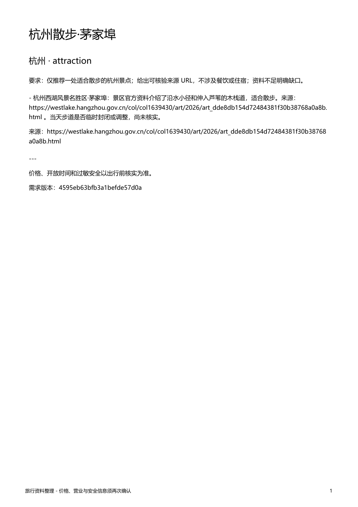

# 复用历史选型，补测新的执行链路

不重复付费重跑旧项目的 Pro/Flash 全套评测。2026-10-09 已完成两组各 10 类场景、共 20 次真实 DeepSeek 官方调用。当前采用 Pro 负责主规划、Flash 负责子任务与无工具审查；偏好提取随主 Agent 完成，不再运行旧项目独立 Wiki 编译模型。

## 历史结果支持什么

旧链路使用固定合成检索资料，两个条件分别为全 Pro，以及 Pro 规划 + Flash 子任务/审查/Wiki。每题每组只跑一次，不能据此承诺新链路收益。

| 指标 | 全 Pro | Pro + Flash |
| --- | ---: | ---: |
| 场景数 | 10 | 10 |
| 意图处置通过 | 9/10 | 9/10 |
| 约束关键词传递 | 33/33 | 33/33 |
| 原始整例自动规则通过 | 8/10 | 6/10 |
| 全请求耗时中位数 | 31.87 秒 | 28.28 秒 |
| 单请求费用估算中位数 | ¥0.03451 | ¥0.02759 |

费用使用当批空闲时段价格和返回的 token usage 估算，非逐例账单实扣。请求耗时不含客户端启动和结束记忆编译。数据复制自旧项目聚合结果，见[metrics](data/deepseek-history-metrics-20261009.json)、[价格快照](data/deepseek-pricing-20261009.json)、[文件校验与来源](data/deepseek-history-provenance.json)。只迁移聚合数据，不携带私密运行日志。

原始规则有 3 例关键词误判：把“已排除的酒店名”当成错误推荐。因此 **8/10 和 6/10 不是事实准确率**。真实问题包括两组漏问目的地、分层组遗漏完整来源 URL；历史两次联网样例也因来源遗漏等原因失败。未采用“性能更快且质量相同”结论。

这支持把分层模型作为降低成本的候选配置，保持来源与约束审查；并不证明新原生子 Agent 的真实效果已合格。官方 API 的当前可用模型和价格，应在下一次真实调用前重新核对。

## 本次补测了什么

- 新旅行模块 42 项回归通过，覆盖 API 协议、原生子任务权限、需求过期、取消、额度、偏好与方案隔离、导出和配置。
- 真正的父子 AIAgent 集成以及官方 Desktop/Gateway 流程已完成；模型和搜索响应固定，不代表真实模型质量。
- 豆包接口已经真实测量 18 次；旧模型数据不能与它相加推算新端到端时延。
- 官方 Langfuse 143 项模拟测试通过，真实服务已入库 2 条 trace / 17 条观测；发现子搜索状态误报与审查调用漏记，见 [观测验收](07-Langfuse.md)。

安装复现曾发现：插件目录名 `travel` 与启用名 `travel-enhancements` 不一致。运行时发现能加载，但 PM 按启用名查找目录，重新激活时会丢掉 ReportLab。已用官方 `enabled_member_dirs()` 的失败测试固定，再统一安装目录与 manifest 名称；安装脚本在重新激活后实际导入 ReportLab，避免仅凭插件注册成功就判定可导出 PDF。

尚缺新的真实 DeepSeek 官方旅行请求：核对 Pro/Flash 实际路由。当前没有可用 `DEEPSEEK_API_KEY`；旧评测凭据仅保存在当时进程中，未随测试报告保存。凭据应写入 Git 忽略的旅行 profile `.env`，无需在聊天或源码中公开。

## 补充：Sol 中转真实链路验收

2026-10-18，用户另行授权使用 `https://ccgoai.club/v1`。其模型列表只有 GPT 系列，没有 DeepSeek；用户随后指定使用 Sol。因此该测试只验证新链路，不替代上面的 DeepSeek 官方选型。

最初 Luna 尝试遇到服务端连续三次“排队超过 30 秒”限制，未产生搜索与方案，已停止并保留[失败回执](data/relay-luna-failure-20261018.json)。11 个已完成 HTTP 响应、最多 12 个上游请求，其中只有 4 个返回 usage；最后在途结果不确定。HTTP 200 不代表模型任务成功。该失败不能用于比较模型能力高低。

随后一条 Sol 请求完成了真实链路：

| 项目 | 实测 |
| --- | --- |
| 请求模型 | gpt-6-sol，主任务/子任务/审查相同 |
| 用户输入 | 合成用户：去杭州，长期喜欢散步，只要一处景点并保存导出 |
| 请求链耗时 | 64.981 秒，含审查和导出，不含初次安装/启动准备 |
| 模型请求 | 10 次，全部返回 usage；全局硬上限 12 次 |
| 输出上限 | 每次请求最多 1600 token |
| 豆包真实搜索 | 1 次，累计额度上限 5；返回 5 个来源 URL |
| 偏好 | 保存 1 条有原话依据的长期偏好 |
| 方案 | 审查后保存 v1，Markdown/PDF 各 1 份 |
| 输入 / 输出 token | 50,088 / 883，总计 50,971（包含各轮重复输入） |
| 费用 | 中转单价与实扣未知；本次搜索约 ¥0.02，仅搜索估算 |

[原始脱敏回执](data/relay-sol-live-20261018.json)、[实际 Markdown](examples/travel-live-sol-v1.md)、[实际 PDF](examples/travel-live-sol-v1.pdf)。已核对来源 URL 在聊天和文档中保留；PDF 一页，中文和“当天通行状态未核实”说明完整。没有独立核验网页全部事实，单次完成不能当成功率或稳定延迟。



复现脚本：[live_flow.py](../../travel_extensions/verification/live_flow.py)。需单独提供忽略目录内的中转 `.env`（`TRAVEL_RELAY_API_KEY`、`TRAVEL_RELAY_BASE_URL`）与搜索 `.env`，经授权后运行：

```powershell
python -m travel_extensions.verification.live_flow --live --model gpt-6-sol --relay-env .hermes-runtime/relay-test.env --search-env .hermes-runtime/profile/.env
```

每次运行都会产生费用，默认官方模型配置不被此测试覆盖。请求次数上限包含模型重试；受控模型响应与服务端真实模型身份无法等同验证。测试 HTTP 转发线程只处理单次隔离验收，不调用 Hermes 上下文 API；官方静态检查对该原生线程给出一项建议，非阻断项。

## 发布前检查

```powershell
python -m travel_extensions.verification.check_release
```

该检查核对新增路径、README/增强文档本地链接、私密运行文件未跟踪，以及常见凭据模式。它只给出静态检查结果，不替代真实 API、完整上游测试或新机器安装。原始 Hermes 核心源码应与基线保持一致；完整差异用 `git diff travel-upstream-baseline-20261018` 查看。

本机官方 `scripts/check --staged --base travel-upstream-baseline-20261018` 的 12 项检查通过。它在待提交快照上运行，不会把 Git 忽略的依赖缓存归入源码；直接对有运行缓存的工作目录扫描，会误报缓存内的临时路径和压缩包。

发布仍需明确 DeepSeek 官方新链路与观测验收的边界。当前只做本地提交，没有推送 GitHub。上游随源码保留的 workflows 面向官方项目，包含组织专用环境；Fork 后应按需要启用，不能将本机通过描述为 GitHub CI 已通过。
