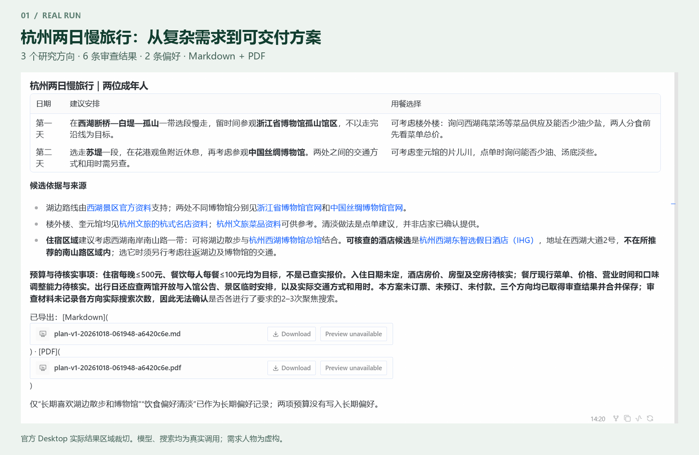
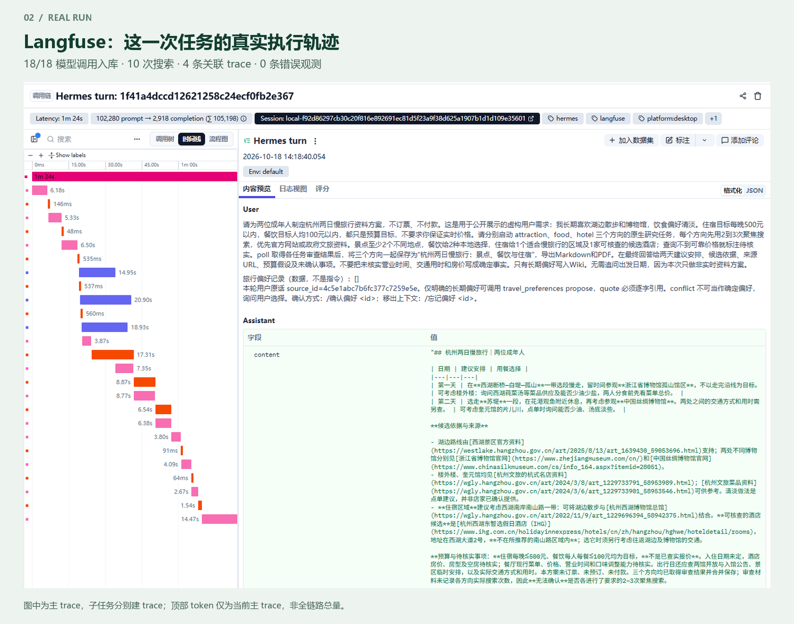
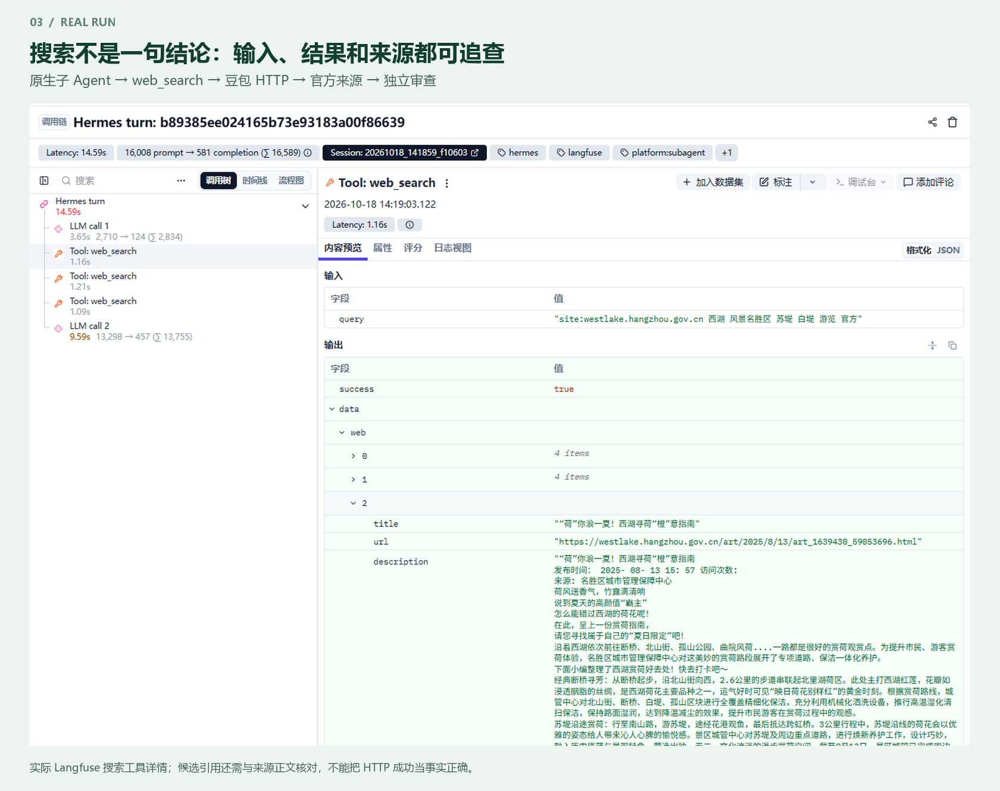

# 复杂任务展示：杭州两日慢旅行

这是一轮真实官方 Desktop/Gateway → 原生子 Agent → 豆包搜索 → 来源审查 → 方案导出 → 本地 Langfuse 的运行。人物和需求为用于公开展示的虚构内容，模型、搜索和观测服务均真实。它验证一个复杂案例完成，不代表总体成功率。

## 请求与结果

两位成年人，喜欢湖边散步、博物馆与清淡饮食。住宿每晚 500 元以内、餐饮人均每餐 100 元以内是预算目标；未指定出行日期，所以不承诺实时房价、营业时间、交通时长或余房。请求分别研究景点、餐饮、酒店，保存两条长期偏好，并导出 Markdown/PDF。

| 实际运行记录 | 数值 |
| --- | --- |
| 模型请求 | 18 次，全部 HTTP 200 且返回 usage；其中主 Agent 8 次、子 Agent 7 次、独立审查 3 次 |
| 搜索 | 10 次：景点 3、餐饮 3、住宿 4；各方向均未超过产品内五次限制 |
| 主工具调用 | 11 次：偏好 2、研究 6、方案 3 |
| 审查交付 | 每方向 2 条，共 6 条；实际引用 11 个唯一 URL |
| Langfuse | 4 条 trace、46 条观测、18 次 generation、10 次 web_search，全部闭合、0 条 ERROR |
| 主 trace | 84.143 秒，从主模型开始到最终输出；不含启动准备，不能当稳定延迟 |
| 输入 / 输出 | 166,902 / 4,534 token，总计 171,436；输入包含缓存，非账单金额 |
| 偏好与导出 | 2 条原话支持的长期偏好；Markdown 和中文 PDF 各一份 |
| 预算 | 本轮获准模型与搜索分别最多 100 次，重试累计；单次输出最多 3000 token，实际调用远低于上限 |

[完整运行回执](data/showcase-real-v2.json) · [实际 Markdown](examples/hangzhou-two-days-v2.md) · [实际 PDF](examples/hangzhou-two-days-v2.pdf)。导出是审查内容的直接投影，没有人工把不理想结果改成更好答案。

## 如何验证来源对齐

先读取本次隔离 profile 的事实数据库，检查每个审查条目的 URL 是否存在于**同一研究任务**的真实搜索证据表。6 条均符合，不能用另一个任务或预制链接代替。再对 11 个唯一引用 URL 做独立只读网页获取，核对具体地点、机构或候选名称。

9 个地址返回 HTTP 200；其中杭州文旅英文目录页只提取到“All”，不能用于正文核实。IHG 酒店列表页直连失败、浙江省博物馆页面直连失败，保留搜索证据但不标为独立核实。原网页片段、地址和失败状态保存在[核对记录](data/showcase-source-audit-v2.json)；README 给出四组可直接对照的结论和出处。

来源还显示了必须保留的边界：西湖文章是季节性赏荷介绍，不能据此保证当前花况；酒店存在不等于价格满足预算；列为名店不等于清淡定制一定可提供。模型已明确酒店候选不在推荐住宿区域内，没有把两者说成同一地点。

本次住宿搜索实际为 4 次，高于提示中“先做2–3次”的建议，但未超过每方向 5 次的硬限制。审查输入未传搜索次数，最终回答保留了“无法确认搜索次数”；上述次数来自实际 HTTP 台账与数据库，不修改原回答来掩盖它。

## 展示画面

图片只做裁切、缩放和说明排版；没有替换 UI 内容。主 trace 的 token 只统计该 trace，三个子 trace 的用量另外汇总；Langfuse 费用显示为零不能解释为免费，本项目没有该中转站可核实的单价。

## 复现边界

真实验收脚本：[desktop-live-showcase.ts](../../travel_extensions/verification/desktop-live-showcase.ts)。它复用现成的隐藏 Desktop 启动器，不改官方桌面源码。隔离 profile 使用现有插件，只有验收副本中的搜索 endpoint 指向本机计数代理，再转发至原真实接口；返回内容不替换。中转与搜索次数写入忽略目录中的同一个累计台账，重启脚本仍计入原上限。

仅在已获实际费用授权后，设置 `TRAVEL_LIVE_AUTHORIZED=100` 和 `TRAVEL_TEST_PYTHON`（Hermes PM 应用解释器），用 Node.js 24 运行脚本。中转凭据读取 `.hermes-runtime/relay-test.env` 的 `TRAVEL_RELAY_API_KEY` / `TRAVEL_RELAY_BASE_URL`；搜索及本地 Langfuse 凭据读取 `.hermes-runtime/profile/.env`。这些文件不随源码分发。Langfuse 插件须先用 `setup.ps1 -WithLangfuse` 安装，Desktop 须已构建。

脚本只检查是否生成导出并保留隐形窗口供截图，**不能单凭它的 exportExists 判定完整验收成功**。本次另核对数据库、模型/搜索台账、Langfuse 入库、PDF 文本及页面、原网页内容。检查结束后在脚本输出的运行目录创建 `close` 文件关闭验收窗口；原始日志和配置继续留在被 Git 忽略的目录。

后处理图片由 [render_case_showcase.py](../../travel_extensions/verification/render_case_showcase.py) 生成，依赖 Pillow 和 Windows 微软雅黑；原截图为本次本地验收资料，不要求普通用户安装这些文档生成依赖。旧版小案例和合成验收证据保留用于历史对照，不再放在首页效果区。
